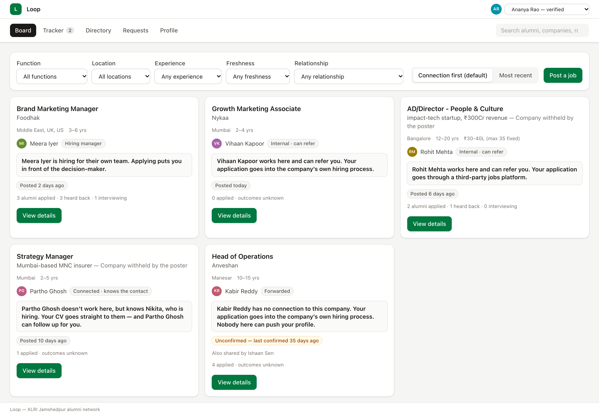
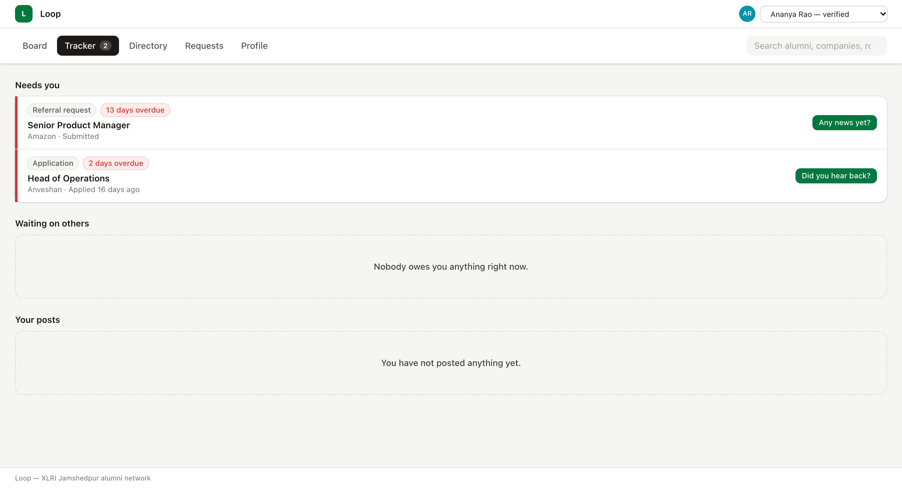
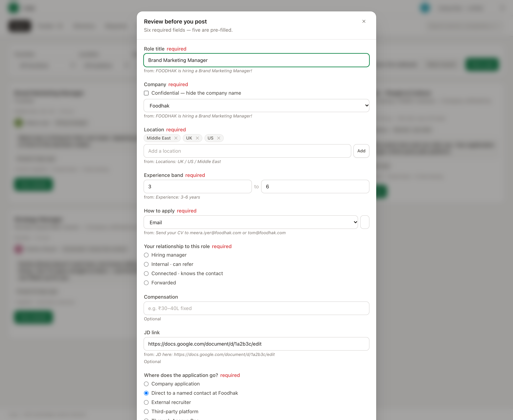
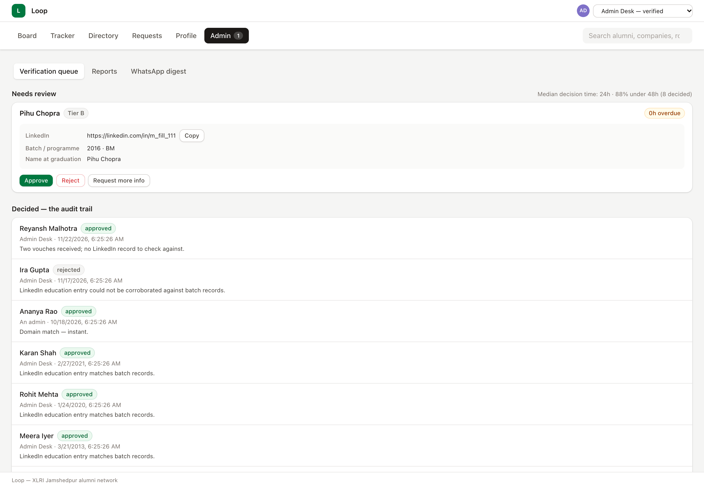
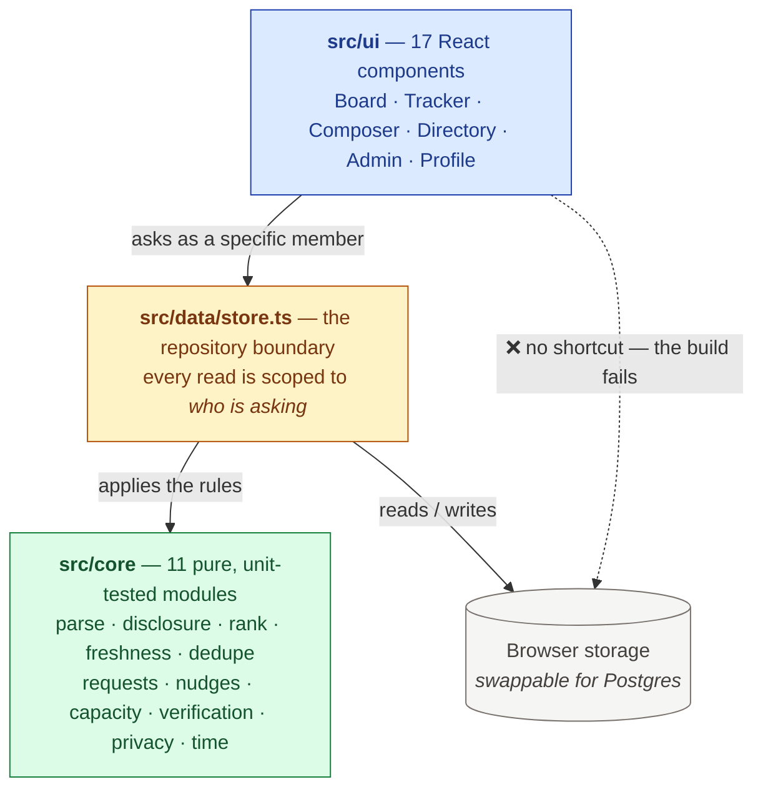
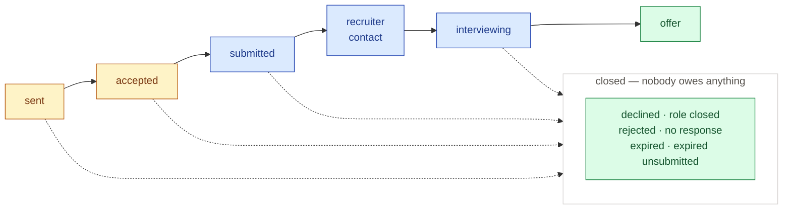

# Loop

**A referral network for the XLRI Jamshedpur alumni community — built from a PRD to a running product.**

Alumni job referrals mostly happen in WhatsApp groups. A job gets forwarded, then forwarded again, and by the time it reaches you nobody knows whether the role is still open, who actually works there, or whether the person who posted it can do anything for you. Someone asks for a referral, the thread goes quiet, and neither side knows whose turn it is.

Loop makes two things explicit that WhatsApp cannot: **what the poster's actual relationship to the role is**, and **who owes the next move**.

> **Status:** runs locally, end to end. `npm run verify` is green — TypeScript clean, **209 tests across 15 files**, an architectural guard passing, production build succeeding.

---

## Run it

```sh
npm install
npm run dev       # → http://localhost:5174
```

```sh
npm run verify    # typecheck + 209 tests + render smoke + production build
```

No API keys, no database, no accounts. Data is seeded in-browser — **226 alumni**, five real job messages, and a handful of live referral threads.

**Use the dropdown in the top-right to switch personas.** It stands in for Google's account chooser. Start as *Ananya Rao* (a seeker with two overdue items), switch to *Meera Iyer* (a hiring manager fielding requests), then *Admin Desk* (the verification queue). *Pihu Chopra*, *Kabir Reddy* and *Ira Gupta* are seeded as pending / unverified / rejected so the membership gate has something to show.

---

## What it looks like

### The board — every card states the poster's real relationship to the role



This is the core product idea. "Referred by a friend" is useless; *"Partho Ghosh doesn't work here, but knows Nikita, who is hiring"* tells you precisely what the connection is worth. A forwarded post says so plainly — **"Nobody here can push your profile"** — even though that makes the post less attractive. Cards are ordered by connection strength first, then freshness, then recency. Stale posts carry a visible decay warning (*"Unconfirmed — last confirmed 35 days ago"*), and a poster who withholds their company shows a descriptor instead.

### The tracker — one surface for everything you owe



The design argument worth noticing: the **referral request** and the **job application** are two completely different objects in the data model, and they render **identically** — same border, same chip, same button weight — separated only by a neutral grey label. Nothing is styled to be more urgent than anything else. Everything is sorted by one question: *who owes the next move?*

### Paste-to-parse — the parser pre-fills, a human always confirms



Paste a WhatsApp message, get a structured post. Every pre-filled field shows **the exact line it came from**, so the poster can check the machine's work rather than trust it. The rule underneath: **a low-confidence field renders empty, never guessed.** An empty field is one more thing to type; a wrongly guessed field is a bad post going live with nobody noticing.

### Admin — verification with a visible audit trail



Membership is the product's whole value, so verification is a real queue, not a checkbox. Every decision records **who decided, when, and why** — including the rejections.

---

## How it works

Three layers, with one deliberate chokepoint between them.



**Why the chokepoint matters.** Privacy is not a check each screen remembers to perform — it is a filter applied once, inside the data layer, on the way out. A screen cannot accidentally leak a private referral thread because a screen cannot reach the data directly in the first place.

That rule is **mechanically enforced, not just documented**. `npm run smoke` scans every UI file for a direct data access, and **fails the build with an explanation** if one appears. It is the one guard the rest of the privacy design rests on, so it is not left to code review.

### The referral lifecycle

Twelve states, and every transition records who is allowed to make it. The colour here is the product thesis — **the system always knows whose turn it is**:



🟡 **referrer** owes the next move  ·  🔵 **seeker** owes it  ·  🟢 closed, nobody owes anything

The solid path is the one everybody hopes for. The dotted arrows are the honest part: a request can end at almost any point, and the system records *how* rather than just going quiet.

A referrer cannot mark themselves as *interviewing*; a seeker cannot mark their own request *submitted*. Each side can only report what it actually knows. States nobody owns time out on a clock rather than sitting open forever — which is what makes the tracker's "who owes this" question answerable at all.

---

## The decisions I made, and what each one cost

This is the part I would most want read. The PRD specified one product; building it surfaced five places where the spec was wrong or unreachable. Each is a judgment call, written down with its trade-off so a later reader doesn't quietly "fix" it back.

### 1. I removed the caps on job seekers, and capped referrers instead

The PRD throttled seekers: a maximum number of open requests, one request per company, and a hard block on asking anyone new while an earlier request sat unresolved.

**I cut all three.** The intent was to protect referrers from being flooded, but the mechanism punished the person with the least power in the exchange — a seeker blocked because someone *else* never replied. So I moved the control to the side that actually experiences the load: referrers set their own intake limits, pause, and auto-decline.

**What this costs:** closing the loop is now encouraged, not enforced. That is a real risk, and the metric that would expose it is loop closure rate. If it drops, the right correction is to show referrers a seeker's unresolved count — not to restore the block.

**What I kept:** the check that stops two alumni submitting the same person for the same role. That one isn't about protecting supply — it costs a referrer their bonus and creates a conflict inside the company's hiring system. Real external harm, so it stays.

### 2. I built a tracker the PRD didn't ask for

The spec had a dashboard for posters and a timeline per request, but no single place where one person sees everything they owe. That is the actual failure mode of referrals — not missing information, but diffuse obligation. The tracker is that surface, and I pulled one "nice-to-have" feature forward (asking for a referral directly from a job post) because without it the tracker has nothing to track.

### 3. No live database

The PRD specifies Postgres with row-level security. Out of reach for a prototype. Instead of scattering the workaround, I put every data access behind one file — so the database swap is a change to one layer, with nothing above it touching.

### 4. No AI parser — and this is the most interesting trade-off

The PRD wanted an LLM reading pasted messages. There's no model here; the parser is plain rules.

I measured what that costs rather than claiming it was free. Across the five real messages, the honest count of fields a human still has to type is **1, 2, 1, 0, 0** — not the uniform "at most one" that would have made a nicer headline.

Message 2 is the genuine failure: it parses a title of *"for a Strategy role with a Mumbai-based MNC insurer"* at just above the confidence threshold, so it pre-fills something visibly wrong instead of staying blank. **I left it in rather than hiding it.** The one-line fix would have made the demo look cleaner while concealing exactly the behaviour a reviewer should see — a parser that is confidently wrong is a worse problem than one that is usefully blank, and that distinction is the point of the whole design.

### 5. Two PRD questions I chose not to answer

An automatic courtesy email to a named hiring contact, and a prompt asking posters to flag applicants. Both touch people who never signed up for Loop. The consent controls the spec actually required all ship.

---

## What I deliberately did not build

Scope discipline, not gaps. Everything below was identified, considered, and cut:

Saved searches · referrer reputation scores · request forwarding · a reciprocity gate on outcome statistics · job alerts · automated WhatsApp sending (the digest is copy-to-clipboard for a human to paste) · real Google sign-in (the persona switcher stands in).

There are also limitations I could have hidden and chose to document instead — including one rule the demo surfaces for a human to honour but does not technically enforce, because enforcing it with a single admin account would make the feature permanently unusable. These are written up in [`STATE.md`](STATE.md).

---

## How this was built

I'm from a business and strategy background, not an engineering one. I used AI coding agents to write this, and I think that's worth stating plainly rather than leaving as an open question.

What that means in practice: **the decisions are mine.** The problem framing, the PRD, the scope cuts, the five judgment calls above, the rulings when a build step turned up something the spec got wrong — the refusal to paper over the parser's weak case. I worked the way I'd want a team to work: write the spec first, break it into verifiable steps, review each one, and record the reasoning where the next person will find it.

The [commit history](https://github.com/Sanchimendiratta/loop/commits/main) shows that method, including the corrections — a security fix on email-domain matching, a privacy bug where profile data was scoped by row but not by field, an accessibility fix on modal focus, and an inert privacy toggle I removed once I realised it changed nothing when flipped. A control that looks like it does something and doesn't is worse than no control at all.

What I take from it: I can hold a product spec and a technical architecture in my head at once, decide what's worth building, and know the difference between a limitation worth shipping and a defect worth stopping for.

---

## Where to look next

| If you want to see | Read |
|---|---|
| Every decision, limitation and known gap, in full | [`STATE.md`](STATE.md) |
| The design reasoning before any code was written | [`docs/superpowers/specs/2026-09-16-loop-design.md`](docs/superpowers/specs/2026-09-16-loop-design.md) |
| The build broken into verifiable steps | [`docs/superpowers/plans/2026-09-16-loop.md`](docs/superpowers/plans/2026-09-16-loop.md) |
| The rules, independent of any screen | [`src/core/`](src/core) — 11 modules, each unit-tested |
| The privacy chokepoint everything rests on | [`src/data/store.ts`](src/data/store.ts) |
| The guard that enforces it | [`scripts/smoke.mjs`](scripts/smoke.mjs) |

**Stack:** React 19 · TypeScript · Tailwind 4 · Vite · Vitest — roughly 8,000 lines of source and 1,800 lines of tests.

The source PRD (`XLRI_Referrals_PRD_v1.md`, v1.3) is an external document and is not included in this repository; section references throughout the docs point to it.
